# StrikeZone

[](https://github.com/muba14/StrikeZone/actions/workflows/build.yml)

**STANDOFF 2** tarzında, botlara karşı oynanan taktiksel bir FPS. Windows için Electron + Three.js ile yapıldı. Tüm dokular, karakterler, silahlar ve sesler kod içinde üretiliyor; dışarıdan hiçbir asset dosyası kullanılmıyor.

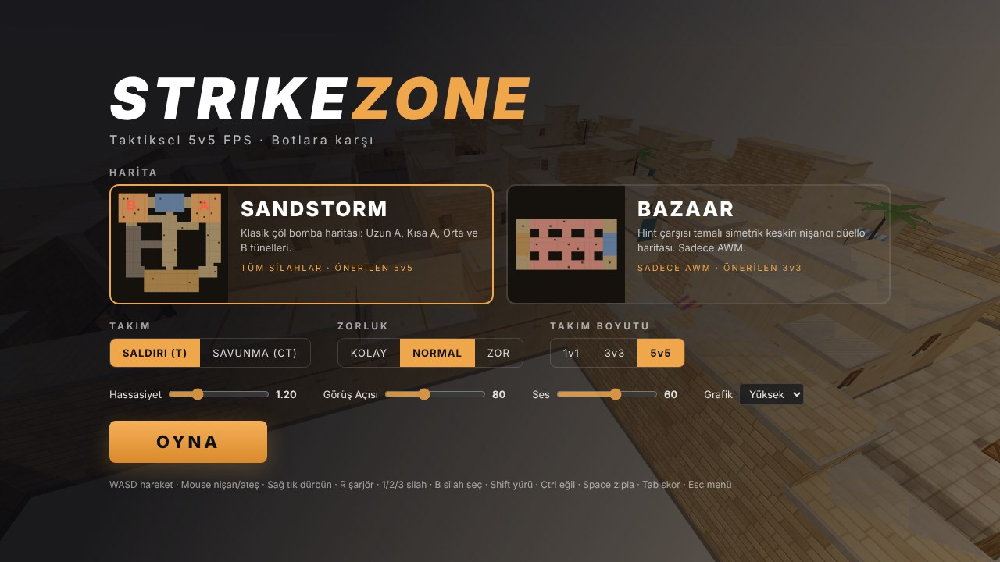

## Ekran görüntüleri

| Sandstorm · Orta | Sandstorm · A bölgesi |
|---|---|
| 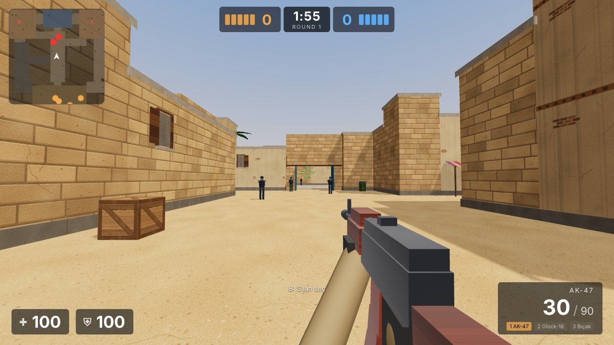 | 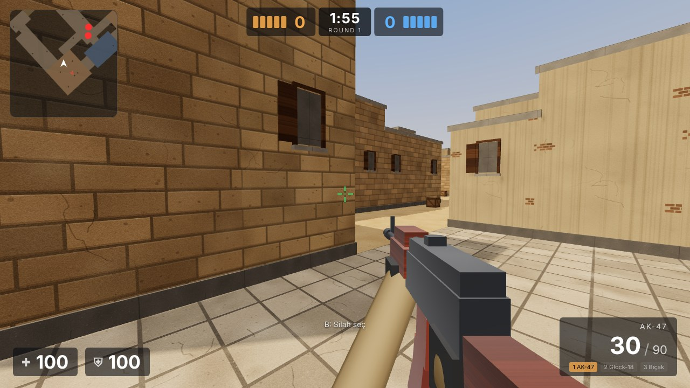 |
| **Sandstorm · B tünelleri** | **Bazaar** |
| 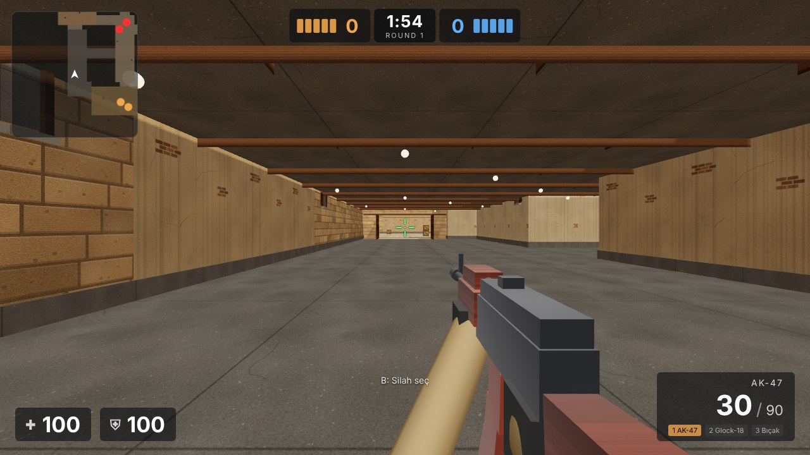 | 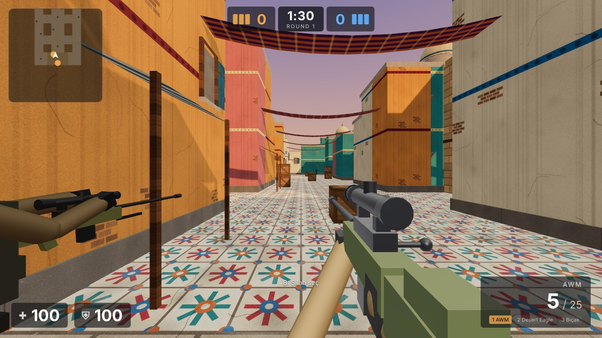 |
| **Satın alma menüsü** | **Bomba kurma** |
| 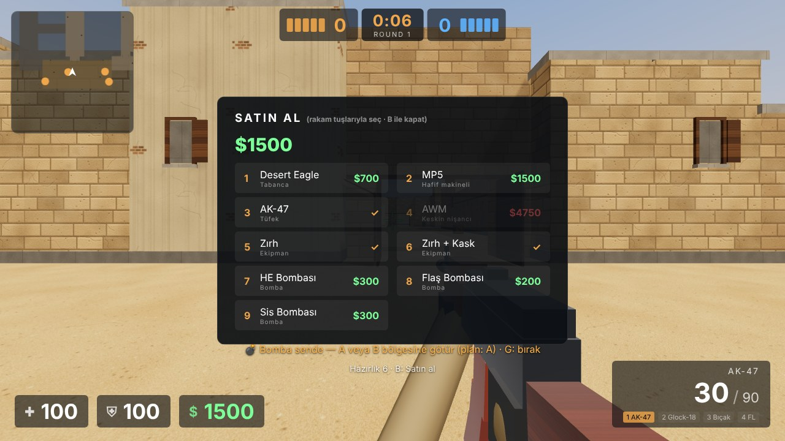 | 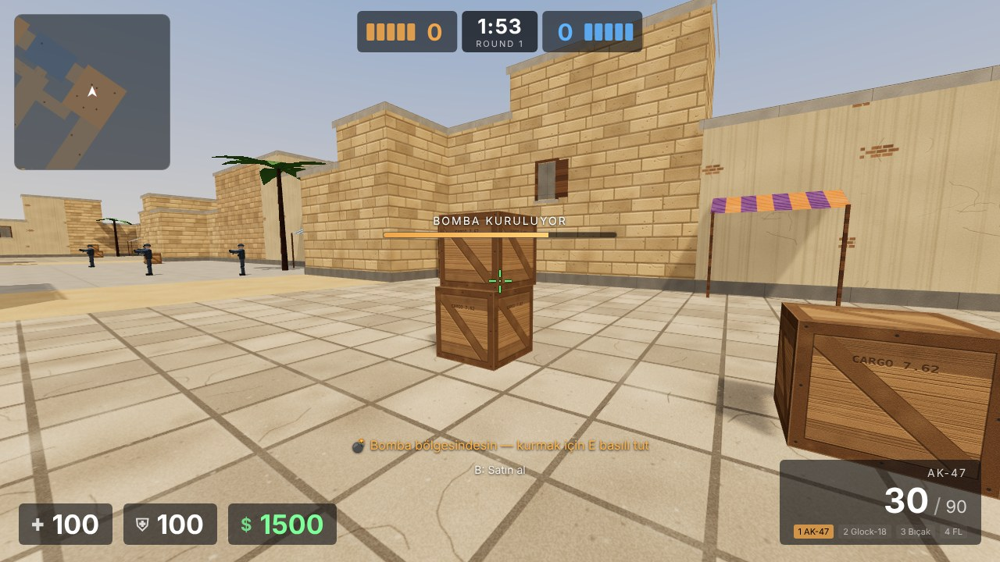 |
| **Bomba kuruldu** | **Sis bombası** |
| 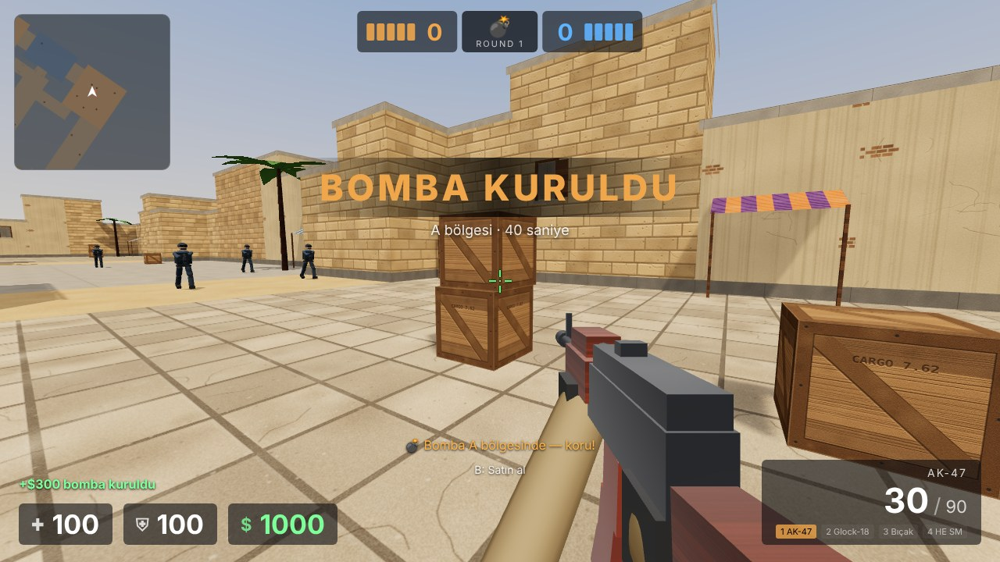 | 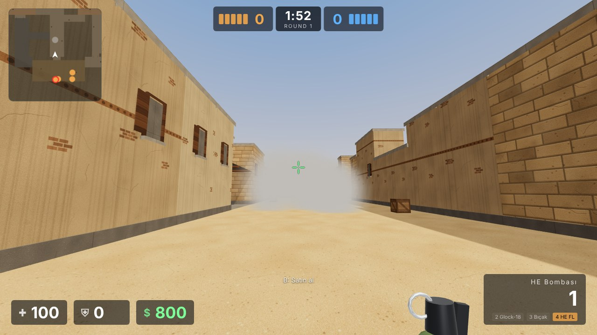 |
| **Kasalar** | **Kasa açma** |
| 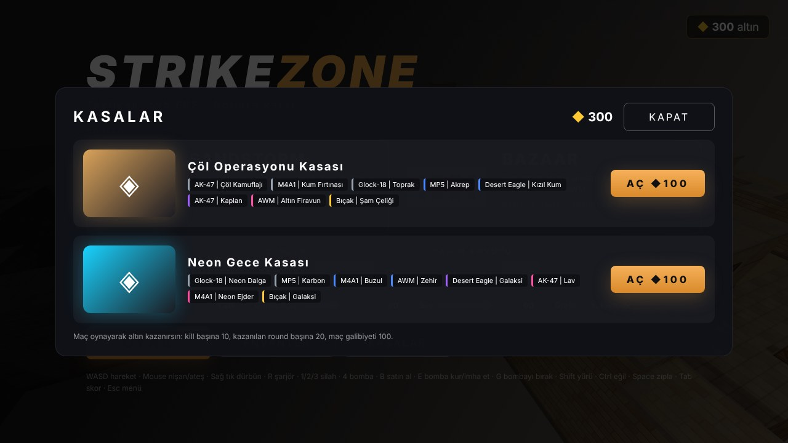 | 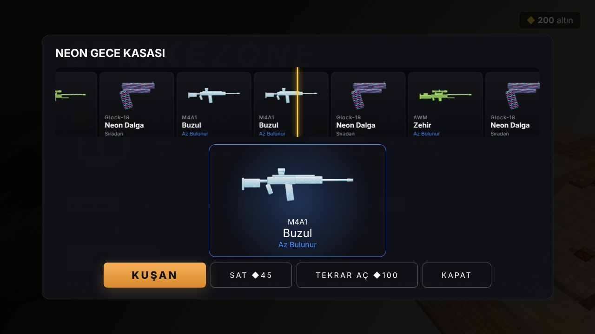 |
| **Envanter** | **Skinler ve yeni karakter modelleri** |
| 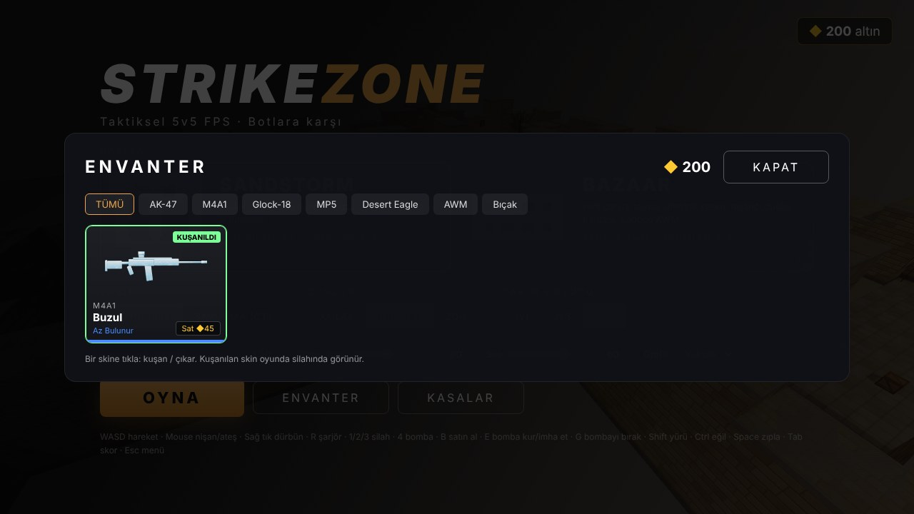 | 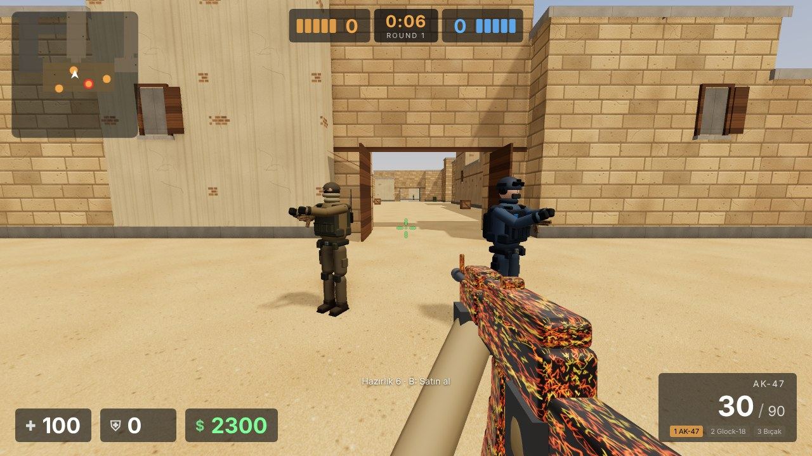 |
| **Killcam** | **Hasar sayıları** |
| 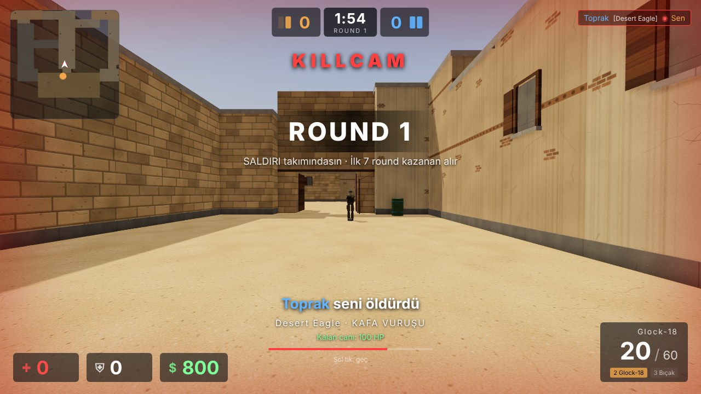 | 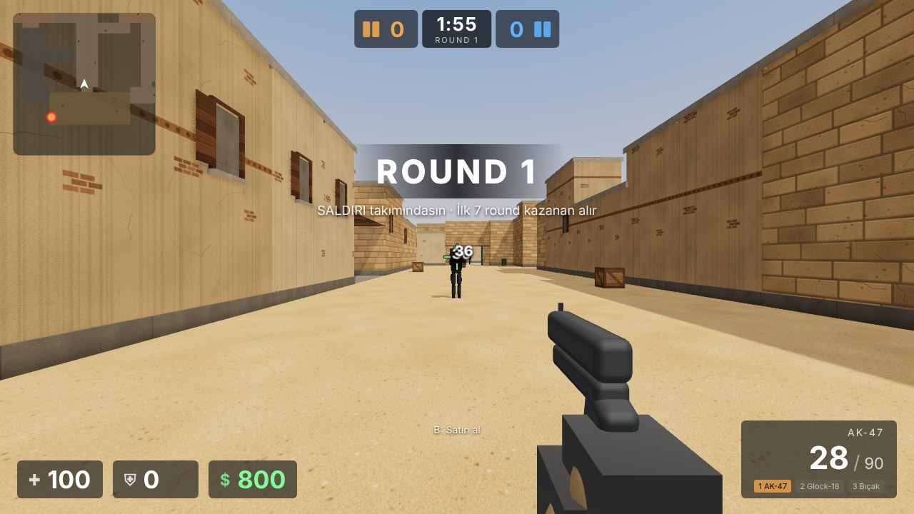 |
| **İstatistikler** | **Nişangâh ayarları** |
| 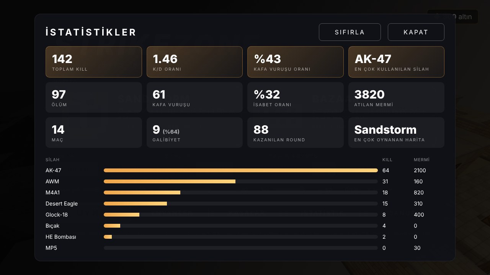 | 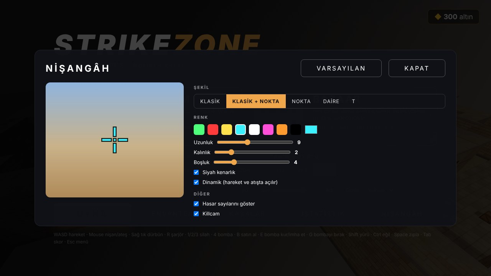 |
| **AWM dürbünü** | |
| 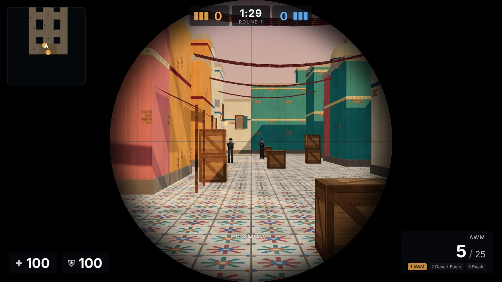 | |

## Özellikler

- **2 harita**
  - **Sandstorm** (bomba modu): Çöl temalı klasik bomba haritası. Uzun A, Kısa A (catwalk), Orta kapılar, üst ve alt B tünelleri, A/B bölgeleri.
  - **Bazaar**: Hint çarşısı temalı, simetrik ve dar koridorlu keskin nişancı düello haritası. Bu haritada sadece AWM var.
- **Bomba kurma / imha modu** (Sandstorm): Saldırı takımında rastgele bir oyuncu bombayı taşır. Bomba A veya B bölgesinde 3,2 saniyede kurulur, 40 saniye sonra patlar. Savunma takımı bombayı 10 saniyede (imha kitiyle 5 saniyede) imha eder. Taşıyıcı ölünce bomba yere düşer, takım arkadaşları onu alabilir. Patlama yakındaki herkese ölümcül hasar verir.
- **Ekonomi**: Başlangıçta $800 verilir, en fazla $16000 birikir. Round galibiyeti $3250 (bomba patlatma/imha ile $3500) getirir. Round kaybı $1400'den başlar ve üst üste her kayıpta $500 artar. Her kill ödül verir (bıçak $1500, MP5 $600, AWM $100, diğerleri $300). Bomba kurmak ve imha etmek +$300. Round'dan sağ çıkan oyuncu silahını ve zırhını bir sonraki rounda taşır.
- **Satın alma**: Desert Eagle, MP5, AK-47 / M4A1 (takıma göre), AWM, zırh, zırh + kask, HE / flaş / sis bombası, imha kiti (sadece savunma). Botlar da paralarına göre alışveriş yapar, para biriktirdikleri eko roundlar oynar.
- **El bombaları**:
  - **HE**: Duvarlardan seken fiziği var, patlama alanında hasar verir.
  - **Flaş**: Bakış açına göre ekranı beyazlatır, kulak çınlatır. Botları da kör eder.
  - **Sis**: 18 saniye görüşü kapatır. Botlar sisin arkasını göremez.

  Botlar da el bombası atar. Saldırı botları bölgeye girerken sis atar.
- **Skinler, envanter ve kasalar**: 2 kasa (Çöl Operasyonu, Neon Gece) içinde toplam 16 skin var: kamuflaj, dijital, kaplan, karbon, buzul, zehir, galaksi, lav, neon ejder, altın firavun, Şam çeliği bıçak ve diğerleri. 5 nadirlik seviyesi var: Sıradan, Az Bulunur, Nadir, Efsanevi, Mitik. Kasa açarken CS tarzı dönen şerit animasyonu ve sesi oynar. Envanterde skin kuşanabilir veya satabilirsin. Kuşandığın skin oyunda silahında görünür. Bazı botlar da skinli silah taşır. Maç oynayarak altın kazanırsın (kill başına 10, kazanılan round başına 20, galibiyet 100). Başlangıçta 300 altın verilir. Envanter bilgisayarına kaydedilir.
- **Killcam**: Öldüğünde son 3 saniye seni öldüren oyuncunun gözünden tekrar oynatılır. Son an ağır çekimde gösterilir. Ekranda öldürenin adı, silahı, kafa vuruşu olup olmadığı ve kalan canı yazar. Sol tıkla geçebilirsin.
- **Hasar sayıları**: Vurduğun yerde hasar miktarı uçarak görünür. Normal vuruş beyaz, kafa vuruşu sarı, öldürücü vuruş kırmızı.
- **İstatistikler**: Toplam kill, K/D, kafa vuruşu oranı, isabet oranı, atılan mermi, maç sayısı ve galibiyet oranı, kazanılan roundlar, en çok oynanan harita ve en çok kullanılan silah tutulur. Silah bazında kill ve mermi grafiği var. Veriler bilgisayara kaydedilir.
- **Nişangâh ayarları**: 5 şekil (Klasik, Klasik + Nokta, Nokta, Daire, T), 8 hazır renk ve özel renk, uzunluk, kalınlık, boşluk, siyah kenarlık ve dinamik mod ayarlanabilir. Canlı önizleme var. Hasar sayıları ve killcam da buradan açılıp kapatılır.
- **6 silah + bıçak**: AK-47, M4A1, AWM (2 kademeli dürbün), MP5, Glock-18, Desert Eagle. Her birinin hasarı, atış hızı, sekmesi (recoil), sprey sapması ve zırh delme değeri farklı.
- **Gerçekçi atış mekaniği**: Kafa vuruşu x4 hasar, bacak vuruşunda daha az hasar, zırh, hareket ederken ve havadayken isabet düşüşü, eğilince isabet artışı, sprey kontrolü.
- **Botlar (yapay zekâ)**: A* ile yol buluyorlar, site tutuyor ya da saldırıyorlar. Görüş açısı ve görüş hattı kontrolü yapıyor, sesi duyup dönüyor, takım arkadaşlarıyla düşman konumunu paylaşıyor, strafe atıp burst atış yapıyorlar. 3 zorluk seviyesi var.
- **Karakterler**: Saldırı askerlerinde balaklava, şal, çöl kamuflajı ve plaka taşıyıcı yelek var. Savunma askerlerinde kask, gece görüş montajı, kulaklık, gözlük ve yüz maskesi var. İkisinde de şarjör cepleri, telsiz, sırt çantası, dizlik, tabanca kılıfı ve botlar var. Yürüme, eğilme ve ölüm animasyonları var.
- **Round sistemi**: 1v1, 3v3 veya 5v5. Hazırlık süresi, round süresi var; ilk 7 roundu kazanan maçı alır. Skor tablosu, kill feed, kafa vuruşu ikonu.
- **HUD**: Dönen radar, can/zırh, cephane, dinamik nişangâh, isabet işareti, hasar yönü göstergesi.
- **Grafik**: PBR malzemeler, yumuşatılmış kenarlı silah modelleri, gölgeler, ACES tone mapping, gökyüzü shader'ı, mermi izleri, namlu alevi, duvarda mermi delikleri, toz ve kan efektleri. Post-processing ayarı grafik seçeneğine bağlı:
  - **Yüksek**: GTAO ortam gölgelemesi + bloom + 4x MSAA
  - **Orta**: Bloom
  - **Düşük**: Post-processing kapalı, gölgeler kapalı
- **Ses**: Tamamı WebAudio ile sentezlendi. Silah sesleri, 3D konumlu bot ayak sesleri, şarjör, kurma, isabet sesleri.

## Kontroller

| Tuş | İşlev |
|---|---|
| WASD | Hareket |
| Mouse | Nişan / ateş |
| Sağ tık | Dürbün (AWM) |
| R | Şarjör değiştir |
| 1 / 2 / 3, Q, tekerlek | Silah değiştir |
| 4 | El bombası seç (tekrar basınca sıradaki bomba) |
| B | Satın alma menüsü (round başında), rakam tuşlarıyla seç |
| E (basılı tut) | Bomba kur / bomba imha et |
| G | Bombayı yere bırak |
| Shift | Yürü (sessiz) |
| Ctrl / C | Eğil |
| Space | Zıpla |
| Tab | Skor tablosu |
| Esc | Duraklat |
| F11 | Tam ekran |

## İndirme

Her push'tan sonra GitHub Actions Windows sürümünü derler:

- **Actions** sekmesi → son "Build Windows" çalışması → **StrikeZone-Windows** artifact'ı (kurulum + portable `.exe`)
- `v1.0.0` gibi bir tag push'larsan `.exe` dosyaları otomatik olarak **Releases**'e de eklenir.

```bash
git tag v1.0.0
git push origin v1.0.0
```

## Geliştirme

```bash
npm install
npm start        # oyunu derler ve Electron'da açar
npm run dist     # Windows kurulum + portable exe üretir (release/)
```

Oyun dosyaları:

| Dosya | İçerik |
|---|---|
| `src/main.js` | Oyun döngüsü, oyuncu, round sistemi, bot yapay zekâsı, HUD |
| `src/world.js` | Harita inşası, çarpışma, raycast, A* yol bulma |
| `src/maps.js` | Sandstorm ve Bazaar harita tanımları |
| `src/characters.js` | Asker modelleri ve animasyon |
| `src/weapons.js` | Silah istatistikleri ve 3D modeller |
| `src/textures.js` | Prosedürel dokular |
| `src/audio.js` | Sentezlenmiş sesler |
| `electron/main.js` | Windows pencere uygulaması |

## Not

Haritalar Standoff 2 / CS haritalarının yerleşiminden **esinlenen özgün** tasarımlardır; orijinal oyunlardan hiçbir asset, isim veya model kullanılmadı.

## Lisans

MIT
